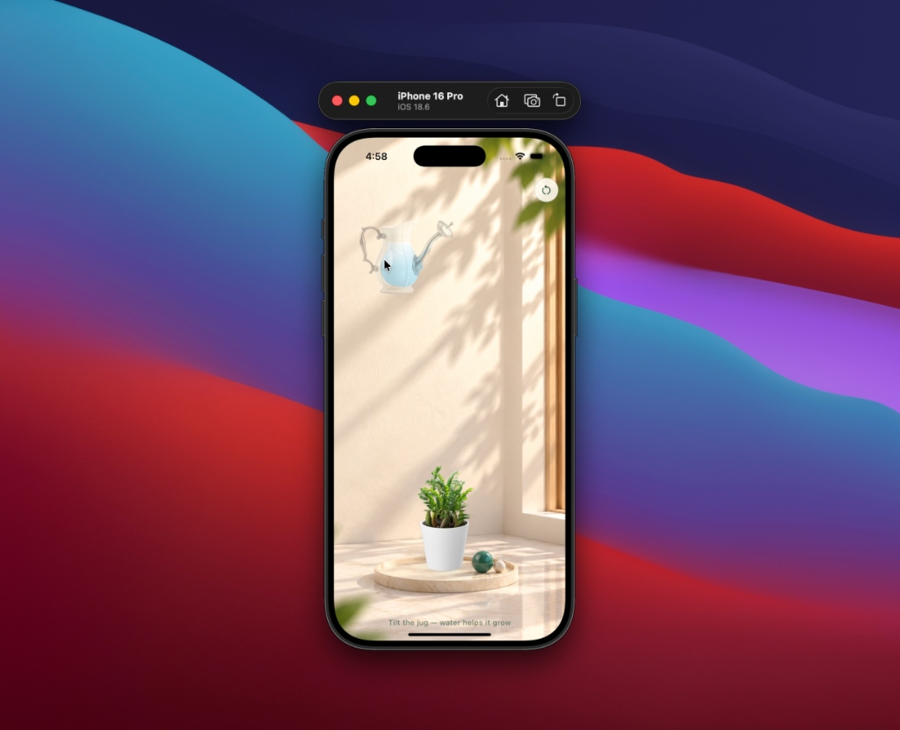
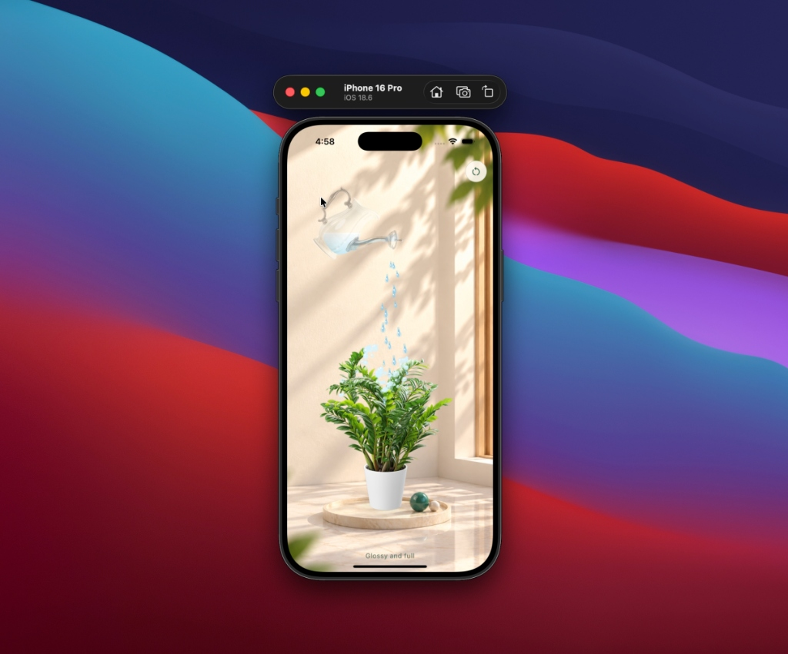

# 🌿 Pour

> An organic, physics-driven interactive plant-watering experience crafted in Flutter.

[](https://flutter.dev)
[](https://dart.dev)
[](https://pub.dev/packages/get)
[](https://flutter.dev)

---

## 📸 Screenshots

<p align="center">
  
  &nbsp;&nbsp;&nbsp;&nbsp;
  
</p>

<p align="center">
  <em>Left: Initial resting state with ambient wind. Right: Interactive water pouring triggering vertex deformation and plant growth.</em>
</p>

---

## ✨ Features

- **Dynamic Mesh Deformation**: Custom 32×40 vertex grid deformation engine rendered via Flutter's `Canvas` and `ImageShader` for fluid plant frond movement and leaf bending.
- **Particle-Based Fluid Physics**:
  - Realistic multi-particle water stream (`Drop`) with velocity vectors and gravity simulation.
  - Water droplet surface beads (`Bead`) adhering to leaf contours based on alpha-channel hit detection.
  - Soil wetness rings (`Ring`) and splash sparks (`Spark`) upon soil contact.
  - Floating ambient dust motes (`Mote`) dancing in natural lighting.
- **Interactive Glass Jug Dynamics**:
  - Intuitive gesture drag & tilt physics with angular momentum, damping, and spring recovery.
  - Dynamic liquid level simulation inside the glass jug that depletes as you pour and naturally refills over time.
- **Growth Progression Milestones**:
  - Ambient captions react dynamically to watering levels:
    1. *"Tilt the jug — water helps it grow"*
    2. *"The soil is drinking"*
    3. *"Leaves are opening"*
    4. *"Almost in full leaf"*
    5. *"Glossy and full"*
- **Sensory & Accessibility Polish**:
  - Tactile haptic feedback on pour flow activation.
  - One-tap smooth reset functionality.
  - Full support for `reduceMotion` accessibility preferences.

---

## 🛠️ Architecture & Tech Stack

```
lib/
├── controllers/
│   ├── pour_binding.dart       # Dependency injection binding (GetX)
│   └── pour_controller.dart    # Physics ticker, vertex mesh generator, particle engine
├── models/
│   └── pour_model.dart         # Frond, Drop, Spark, Bead, Ring, and Mote data structures
├── views/
│   └── pour_view.dart          # CustomPainter viewport, gesture detectors, responsive layout
└── main.dart                   # Application entry point & theme configuration
```

- **Framework**: [Flutter](https://flutter.dev)
- **State Management**: [GetX](https://pub.dev/packages/get)
- **Audio Engine**: [audioplayers](https://pub.dev/packages/audioplayers)
- **Graphics Pipeline**: `dart:ui` custom shaders, vertices triangulation, and low-level canvas painting.

---

## 🚀 Getting Started

### Prerequisites

- Flutter SDK (>= 3.10.1)
- Dart SDK
- Xcode (for iOS / macOS builds) or Android Studio (for Android builds)

### Installation

1. **Clone the repository**:
   ```bash
   git clone https://github.com/Hamad-Anwar/pour.git
   cd pour
   ```

2. **Install dependencies**:
   ```bash
   flutter pub get
   ```

3. **Run the app**:
   ```bash
   flutter run
   ```

---

## 🎮 How to Play / Interact

1. **Grab & Tilt the Jug**: Press and drag or tilt the watering jug towards the plant.
2. **Water the Plant**: Direct the stream of falling water droplets onto the plant foliage and soil.
3. **Watch It Flourish**: As the soil absorbs moisture, observe the fronds gently bend, uncurl, and bloom into a lush, full plant.
4. **Reset Anytime**: Tap the subtle reset button in the top-right corner to return to the sapling stage.

---

## 📄 License

This project is open-source and available under the [MIT License](LICENSE).
